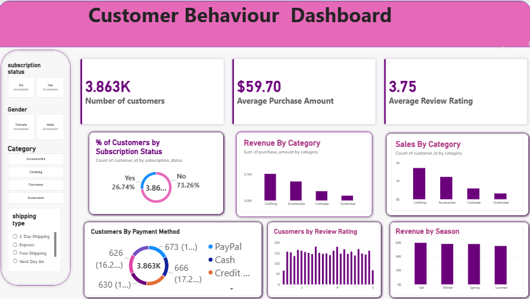

# Customer Shopping Behaviour Analysis

## Project Overview
This project analyzes customer shopping behaviour to understand purchasing patterns, customer preferences, revenue trends, and subscription behaviour.

## Tools Used
- MySQL
- Power BI
- SQL
- Python
- CSV Dataset

## Dashboard Preview

## Key Performance Indicators
- Total Customers: 3,863
- Average Purchase Amount: $59.70
- Average Review Rating: 3.75

## Dashboard Insights
- Customer subscription status analysis
- Revenue by category
- Sales by category
- Customers by payment method
- Customer review rating analysis
- Revenue by season
- Interactive filters for customer analysis

## Project Files
- `customer_shopping_behavior.csv` — Dataset
- `Customer_Shopping_Analysis_SQL.docx` — SQL analysis document
- `customer_dashboard.pbix` — Power BI dashboard
- `dashboard.png` — Dashboard screenshot

## Project Objective
To analyze customer shopping behaviour and identify useful business insights that support data-driven decision-making.

## Author
Rabiyathul Basiriya S
